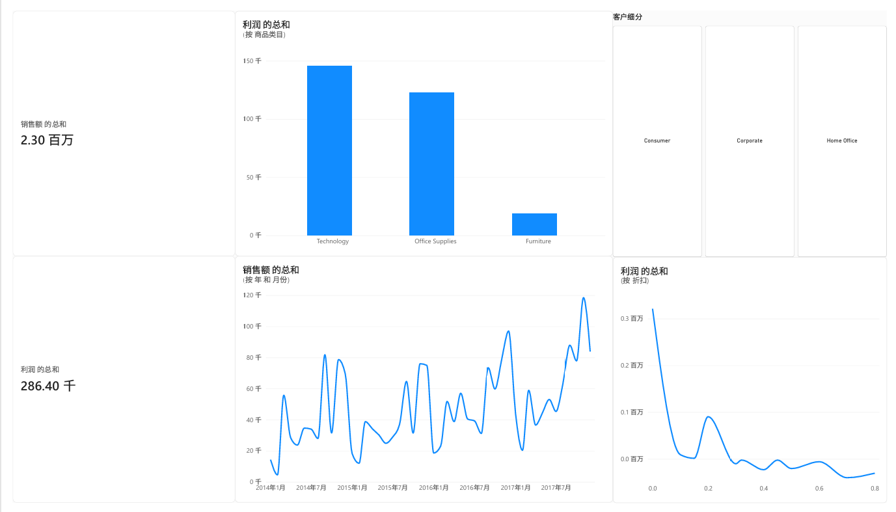
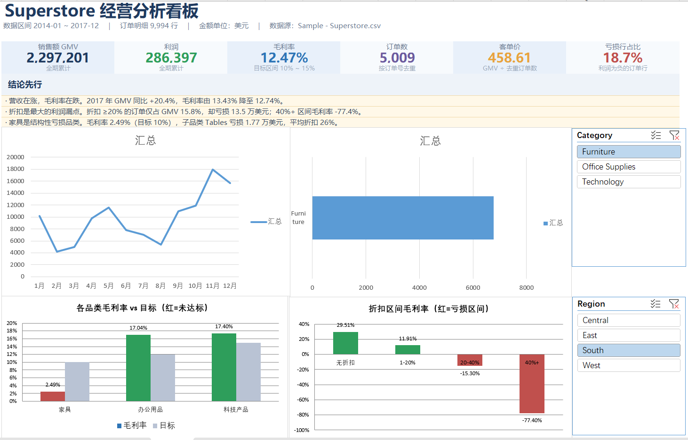
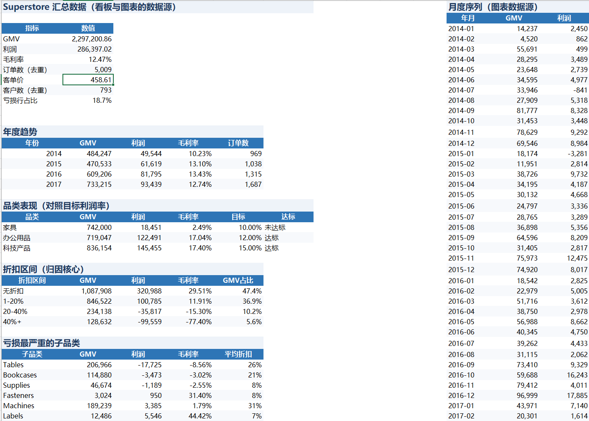

# Superstore 经营分析（MySQL + Power BI + Excel）

用 4 年、9,994 行零售订单，回答一个业务问题：**销售额在涨，利润为什么没涨？**
链路：CSV → MySQL → Power BI 看板 → Excel 一页纸月报。

## 核心结论

| GMV | 利润 | 毛利率 | 订单数 | 客单价 | 亏损行占比 |
|---:|---:|---:|---:|---:|---:|
| 2,297,201 | 286,397 | 12.47% | 5,009 | 458.61 | 18.7% |

1. **折扣是最大的利润漏点**：折扣 ≥20% 的订单只占 GMV 15.8%，却合计亏损 13.5 万美元；其中 40%+ 区间毛利率 **-77.4%**。
2. **家具是结构性亏损品类**：毛利率仅 **2.49%**（目标 10%），子品类 `Tables` 亏损 1.77 万美元、平均折扣 26%。
3. **增收不增利**：2017 年 GMV 同比 **+20.4%**，毛利率却由 13.43% 降至 12.74%。
4. **区域分化明显**：West 毛利率 14.9%，Central 只有 7.9%，不到 West 的六成。

## 看板与报表

### 1. Power BI 交互看板 · `Superstore_Dashboard.pbix`



GMV / 利润两张 KPI 卡，按商品类目的利润对比，按年月的销售额趋势，客户细分（Consumer / Corporate / Home Office）切片器。

### 2. Excel 经营看板 · `Superstore_Report.xlsx`



一页 A4 横向：6 张 KPI 卡 + 3 条结论 + 月度趋势与品类图表，Category / Region 切片器联动；KPI 用 `SUM` / `SUMPRODUCT` 公式实时计算，不是写死的数字。

### 3. Excel 数据汇总 · 同一文件的「汇总」表



各维度预聚合结果（指标、年度、品类、折扣区间、亏损子品类、区域、月度序列），是看板与全部图表的唯一数据源——口径集中在一处，改一处全表更新。

## 技术栈

| 环节 | 工具 |
|---|---|
| 数据库 | MySQL 8.0（本地服务 + Navicat 客户端管理） |
| BI | Power BI Desktop |
| 表格 | Excel（`SUMIFS`、`XLOOKUP`、透视表、切片器、条件格式） |
| 数据接入 | Python + SQLAlchemy → MySQL |

## 项目结构

```text
superstore_bi/
├── data/Sample - Superstore.csv   # 原始数据（9,994 行 × 21 列）
├── import_data.py                 # CSV → MySQL（orders 库）
├── Superstore_Dashboard.pbix      # Power BI 看板
├── Superstore_Report.xlsx         # Excel 看板 + 汇总 + 数据字典
├── dashboard_screenshot.png       # Power BI 截图
├── xlsx_data.png                  # Excel 看板截图
├── xlsx_data2.png                 # Excel 汇总表截图
└── requirements.txt
```

## 运行

```bash
pip install -r requirements.txt
python import_data.py      # 建库 orders 后执行，写入 9,994 行订单
```

BI 与报表部分直接打开 `Superstore_Dashboard.pbix`、`Superstore_Report.xlsx` 即可，Excel 表中的公式会随「汇总」表更新。

## 口径说明

- 金额单位为美元，统计全部已下单记录（数据集无订单状态字段）；
- 订单数按 `Order ID` 去重为 5,009，客单价 = GMV ÷ 去重订单数（不是÷明细行数）；
- 毛利率 = `SUM(Profit) / SUM(Sales)`，先汇总后相除，不是各行利润率的平均；
- 折扣区间划分为 0 / 1–20% / 20–40% / 40%+ 四档。

## 局限

- 数据为公开样本（2014–2017），不含成本明细与退货记录，利润口径以数据集自带的 `Profit` 为准；
- MySQL 为本地单机配置，未做索引与分区优化。
